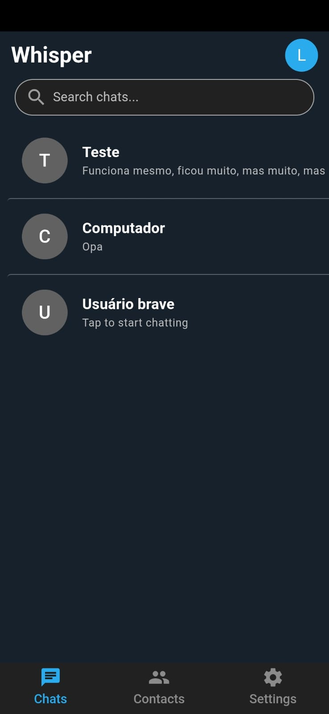
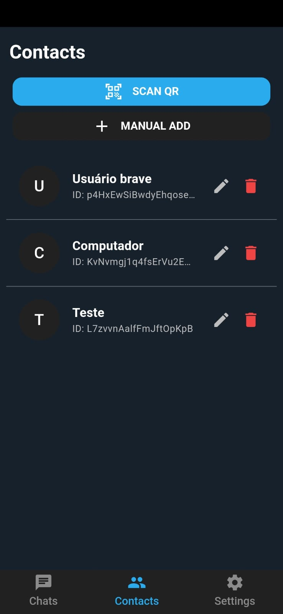
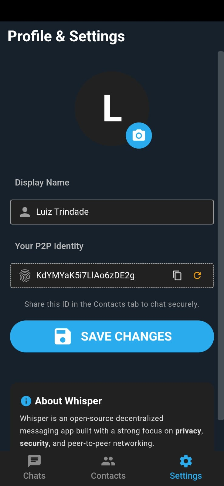
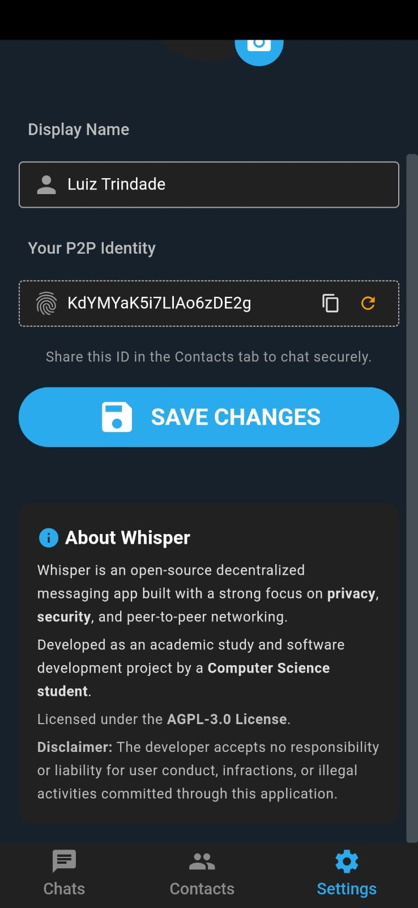

# 💬 Whisper

A minimal, decentralized, peer-to-peer (P2P) messaging application with a store-and-forward cloud queue backup. Designed with a strict focus on privacy, security, and high performance without relying on a centralized database server.

---

## 📸 Screenshots

<p align="center">
  
  
  
  
</p>

---

## ✨ Features

- **WebRTC Direct P2P Messaging**: Ultra-fast, encrypted peer-to-peer messaging using WebRTC via Trystero.
- **E2EE**: End-to-end encryption for private messaging.
- **MQTT Cloud Queue Fallback**: Offline messaging support using MQTT Retained Messages. If your peer is offline, messages are stored in the broker cloud queue and automatically delivered and cleared once they reconnect.
- **Privacy & Local Storage**: All messages, contact list, and profile info are stored locally on your device via `localforage` (IndexedDB/Local Storage).
- **QR Code Quick Pairing**: Instantly add contacts by scanning their QR code using the built-in HTML5 camera scanner.
- **100% Flat & Minimalist UI**: Clean, modern dark mode design built with Quasar Framework without clutter or intrusive indicators.
- **Zero Centralized Database**: No sign-ups, passwords, or personal data collection on centralized backend servers.

---

## 🏗️ Architecture & How It Works

1. **Direct Connection (Online)**: When both peers are active in the chat, messages are delivered directly over WebRTC Data Channels with zero server involvement.
2. **Offline Store-and-Forward (MQTT Queue)**:
    - When sending a message, it is published to the MQTT broker under a deterministic topic with `retain: true`.
    - You can safely close the app after sending.
    - Once your contact opens the app, their client subscribes to the room topic, downloads all pending cloud messages, saves them locally, and clears the topic queue on the broker.

---

## 🛠️ Tech Stack

- **Framework**: [Vue 3](https://vuejs.org/) (Composition API)
- **UI Toolkit**: [Quasar Framework](https://quasar.dev/)
- **P2P Signaling**: [@trystero-p2p/mqtt](https://github.com/dmotz/trystero)
- **MQTT Engine**: [MQTT.js](https://github.com/mqttjs/MQTT.js)
- **Local Persistence**: [localforage](https://github.com/localForage/localForage)
- **QR Code Handling**: `qrcode.vue` & `html5-qrcode`

---

## 🚀 Getting Started

### Prerequisites

Make sure you have Node.js (v18+) installed on your machine.

### Installation

```bash
# Clone the repository
git clone [https://github.com/your-username/whisper.git](https://github.com/your-username/whisper.git)

# Navigate into the project directory
cd whisper

# Install dependencies
npm install

# Start the development server
npm run dev
```
